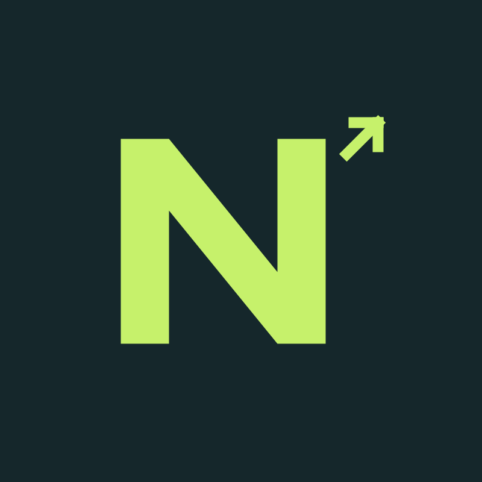

# NexoByte Tech

### Connected ideas. Purposeful software.

**Web Development · Custom Software · Digital Communication**

We build digital solutions that connect businesses, people, and ideas.

[Explore our website](https://nexobyte-tech-hq.github.io/) · [Discuss your project](mailto:jeremy.voss@pixelsoftgames.com) · [Browse our repositories](https://github.com/orgs/nexobyte-tech-hq/repositories)

---

## Technology with a clear purpose

NexoByte Tech is a technology initiative focused on web experiences, custom software, and communication integrations for businesses and entrepreneurs.

We start by understanding the problem, defining what matters, and shaping a practical solution with a clear scope and room to evolve.

## What we build

| Area | Focus |
| --- | --- |
| **Web experiences** | Business websites, landing pages, and responsive web applications. |
| **Custom software** | Internal tools, dashboards, and applications tailored to business workflows. |
| **Integrations & automation** | Connections between systems that simplify tasks and improve information flow. |
| **Digital communication** | Contact, messaging, and calling integrations based on each project’s requirements and platforms. |

## Our approach

**Understand → Define → Build → Validate**

Understand the goal and users. Agree on scope and deliverables. Develop through reviewable progress. Check functionality and document the handover.

## Explore our work

Our [business website](https://nexobyte-tech-hq.github.io/) introduces NexoByte Tech and our areas of work. Its [source repository](https://github.com/nexobyte-tech-hq/nexobyte-tech-hq.github.io) contains the website code and documentation.

As our work develops, we will share additional projects, demonstrations, and technical documentation here. Each repository will describe its purpose, setup, and current state.

## Let’s connect

Have an idea, need a website, or want to improve a business workflow? Tell us what you want to achieve.

**Email:** [jeremy.voss@pixelsoftgames.com](mailto:jeremy.voss@pixelsoftgames.com)

**Website:** [nexobyte-tech-hq.github.io](https://nexobyte-tech-hq.github.io/)

---

**NexoByte Tech**

Design. Develop. Connect.

